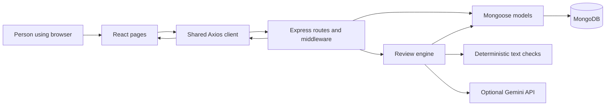
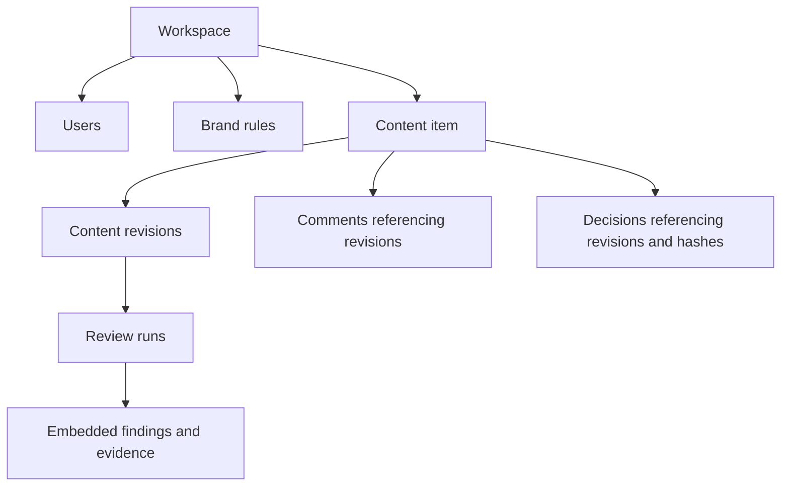
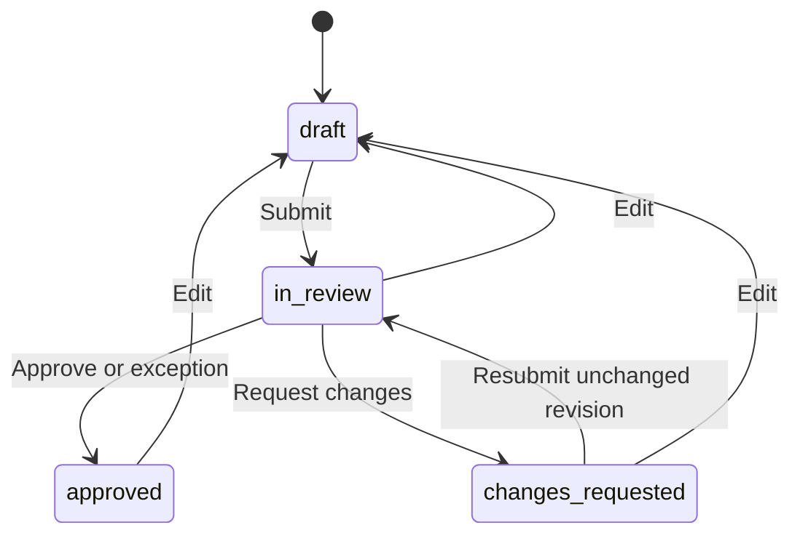

# Understanding BrandGuard

Prepared from the repository on 14 November 2026. This guide describes the code, including the new scrolling, theme and scheduled health-ping changes. A feature existing locally does not establish that the public deployment contains it. Historical work below is reconstructed from Git and the submission notes; it is not a claim that this chat performed every earlier change.

## Start with the problem

A marketing team can have several people writing copy while product names, prices and offers change. Someone may use an old trial duration or make a claim that nobody has approved. BrandGuard gives the team one place to keep approved guidance, check a draft against it, discuss findings and record a human decision about a specific version of the text.

For example, the demo brand is AcmeFlow. Its approved trial is 14 days. A creator writes “Try ACME flow with a 30-day free trial.” BrandGuard can identify the nonstandard name and outdated offer using stored rules, suggest replacements, and preserve each edit as a revision. A different authorised person then approves the submission or requests changes.

The checks assist the reviewer. A completed analysis does not mean the content has been approved, and a flagged claim is not automatically proven false.

## What the project contains and how it developed

The initial commit on 8 November contains the React application, Express API, database models, deterministic checks, optional Gemini adapter, demo data and review workflow. A later commit that day adjusts deployment cookies and proxy trust. The 13 November commits add or refine browser preferences, session role refresh, workspace onboarding, membership approval, team controls, navigation and workflow protections. The Round 3 document records three main improvements: shared workspace onboarding, administrator role management and personal appearance settings.

The current changes add Lenis scrolling, motion styles, a midnight blue/teal theme, blue navigation, a shared preference hook, a header theme switch, and a production health-ping timer that skips 1–5 AM IST.

You can explain your work by feature, then show the relevant files. Avoid claiming that every feature was added in one particular round unless the original round submission supports that history.

## The architecture in plain language

The browser runs React. React displays screens and keeps temporary UI state such as form values. Axios sends HTTP requests to Express. Express validates the request, checks who the user is and what they can do, and uses Mongoose to read or write MongoDB. Services perform the review logic. JSON responses travel back to React, which renders the updated screen.



MongoDB is the database. Mongoose is the JavaScript library used to describe and access its documents. Node.js runs the server process. Express is the HTTP framework running inside Node. Vite builds and serves the frontend during development. React Router decides which screen belongs to a browser URL.

This is a client/server monorepo: two applications live in one repository, managed by npm workspaces. It is not a microservice system. There is no separate controller directory: most HTTP handlers are implemented directly in the route files.

## A vocabulary you can use when reading the code

| Term | Meaning in this application |
|---|---|
| Component | A function describing a piece of React UI, such as the sidebar or a finding card. |
| State | A value React remembers between renders, such as the current form or loading flag. |
| Effect | Code that synchronises React with something outside rendering, such as an API request or browser event listener. |
| Context | Shared React data. `AuthContext` exposes the signed-in user and session actions to many screens. |
| Route | A method and path handled by Express, or a browser path mapped to a React page. These are separate kinds of routing. |
| Middleware | A function that runs along the Express request path, such as `requireAuth`. |
| Schema | A description of allowed data. Zod validates incoming values; Mongoose describes stored documents. |
| Model | The Mongoose interface used for database operations such as `User.findOne()`. |
| Service | Reusable backend work, such as creating a review run or recording activity. |
| ObjectId | A MongoDB record identifier. It is not an access credential. |
| `populate()` | Mongoose replaces selected reference IDs with related records for the response. It does not merge those records in storage. |
| Hash | A fingerprint of text. The SHA-256 content hash is neither encryption nor a digital signature. |
| Tenant | One customer/team boundary. BrandGuard uses a workspace as that boundary. |

## Every project file and its responsibility

This inventory covers authored source, configuration, tests, documentation and the tracked PDF. Dependencies inside `node_modules`, Vite output in `client/dist`, Git's internal files and private `.env` values are not application source you should memorise. A real `server/.env` is present locally; its contents are private and are deliberately not reproduced here.

### Root and delivery files

| File | Responsibility and connection |
|---|---|
| `package.json` | Declares the `client` and `server` workspaces. `dev` starts both via `concurrently`; `seed`, `test` and `build` delegate to a workspace. It is the root command menu. |
| `package-lock.json` | Pins the resolved dependency graph and integrity checks. It changes when dependencies such as Lenis are installed. Commit it with dependency changes. |
| `.gitignore` | Excludes installed packages, environment secrets, compiled output, logs, coverage and temporary PDF previews. `.env.example` remains tracked. |
| `.nvmrc` | Requests Node 20 for version managers that read this file. It does not itself install or switch Node. |
| `docker-compose.yml` | Describes a local MongoDB 7 container, port mapping and persistent volume. It does not containerise the frontend or API. |
| `README.md` | Setup, configuration, commands, demo accounts, architecture overview and deployment instructions. |
| `docs/PRODUCT_SCOPE.md` | Product intent, roles, review concepts and planned extensions. Some statements are intended policy; consult handlers for exact enforcement. |
| `docs/ARCHITECTURE.md` | Architecture diagram and intended workflow invariants. |
| `docs/ROUND3_SUBMISSION.md` | Historical feature inventory, three improvements, recorded test results, release checklist and roadmap. |
| `docs/PROJECT_WALKTHROUGH.md` | This file: source responsibilities, request traces, limits and interview explanations. |
| `output/pdf/BrandGuard-Round3-Product.pdf` | A submission artifact. The running app does not read it. Its contents were not re-rendered or revised as part of the UI changes. |

### Frontend startup and shared code

| File | Responsibility and connection |
|---|---|
| `client/package.json` | Frontend dependencies and Vite development/build/preview scripts. Includes React, React Router, Axios, Lucide icons and Lenis. |
| `client/.env.example` | Shows `VITE_API_URL`. Vite substitutes this public API address into the build; it must never contain secrets. |
| `client/vite.config.js` | Enables the React plugin and reserves development port 5173 with `strictPort`. |
| `client/index.html` | HTML entry document, metadata, font links, the `root` element and module entry for `main.jsx`. |
| `client/public/_redirects` | Netlify rewrite `/* /index.html 200`. A direct request for `/profile` receives the SPA entry, after which React Router renders Profile. |
| `client/src/main.jsx` | Applies the saved theme before mounting React. Installs routing, smooth scrolling and authentication around `App`; imports layout, theme and motion styles. |
| `client/src/App.jsx` | Shows loading while restoring the session, Login when unauthenticated, and nested application routes when authenticated. Unknown authenticated routes redirect home. |
| `client/src/styles.css` | Original component layouts, spacing, typography, grids, responsive breakpoints and base styles. The old incomplete dark overrides have been removed. |
| `client/src/themes.css` | Semantic color variables for light and midnight themes, blue navigation, dark surfaces, text, fields, findings, badges and dialogs. Also defines modal scroll locking and focus treatment. |
| `client/src/motion.css` | Page/card entrances, hover/press feedback, menu/dialog animation and reduced-motion overrides. Uses CSS transitions and keyframes rather than React updates on each scroll frame. |
| `client/src/utils.js` | Small presentation helpers: dates, relative time, initials, readable labels, and mappings from status/severity to visual styles. |
| `client/src/preferences.js` | Reads and normalises the browser's stored preferences. Saves them under `brandguard.appPreferences`, applies the theme and emits a change event. Invalid stored values fall back to defaults. |
| `client/src/hooks/usePreferences.js` | Gives components current preferences, an update function and storage errors. Subscribes to in-tab preference events and cross-tab storage events so the header and Settings stay in sync. |
| `client/src/api/client.js` | One configured Axios instance: API base URL, JSON headers, credentialed cookies and 30-second timeout. An interceptor adds `error.userMessage` for screens to display. |
| `client/src/context/AuthContext.jsx` | Restores `/auth/me`, stores the safe user object and exposes login/register/logout. Refetches the user on window focus to reflect permission changes. It does not store the JWT in local storage. |
| `client/src/components/AppLayout.jsx` | Shared sidebar, top bar, breadcrumbs, account menu, mobile navigation, search shortcut, session notice and page outlet. Search navigates to the review queue with a query parameter. |
| `client/src/components/SmoothScroll.jsx` | Creates one Lenis instance, resets scroll on pathname changes and destroys listeners/animation work on cleanup. Reduced-motion users get native scrolling. Editors, sidebar, tables and dialogs keep native nested scrolling. |
| `client/src/components/ThemeToggle.jsx` | Header button switching light/midnight appearance through the shared preference hook. Provides an accessible label and reports save failures. |

### Frontend pages

| File | Responsibility and connection |
|---|---|
| `client/src/pages/Login.jsx` | Login/registration forms, password visibility, role selection, demo shortcuts and membership notices. Debounces workspace lookup by 350 ms; sends credentials through AuthContext. |
| `client/src/pages/Dashboard.jsx` | Fetches `/dashboard/summary` for counts, recent items and activity. Eligible admins also fetch members, decide pending access and change roles. `MetricCard` and `EmptyPanel` are helper components inside this file. |
| `client/src/pages/Reviews.jsx` | Fetches the review list; filters the returned items by status, title and creator name in browser memory. Synchronises search with `?q=` and opens a selected review. The API currently caps the list at 100. |
| `client/src/pages/NewReview.jsx` | Controlled form for title, channel, audience, objective and text. Reads the preferred channel, offers sample copy, posts `/reviews` and navigates to the returned item ID. |
| `client/src/pages/ReviewDetail.jsx` | Loads item, revisions, runs, comments and decisions. Selects the latest run for the current revision. Handles edits, applying suggestions, rechecking, finding dispositions, comments, submission and decisions; reloads details after a successful action. `FindingCard` and `Badge` live here. |
| `client/src/pages/BrandBrain.jsx` | Loads rules and workspace AI settings. Shows guidance cards, an add-rule modal, draft-rule approval and the admin AI switch. The API supports retirement, but this UI does not expose a retirement button. |
| `client/src/pages/Insights.jsx` | Fetches aggregated data and renders counts and category bars. The API samples the most recent 200 runs; this is not an unlimited analytics warehouse. |
| `client/src/pages/Profile.jsx` | Displays name, email, role and workspace and provides sign-out. It is read-only; the backend has no profile-edit endpoint. |
| `client/src/pages/AppSettings.jsx` | Compact lists, preferred channel, appearance and defaults. Preferences save in the browser. Eligible accounts can request deactivation by confirming their password. |

### Backend startup, middleware and helpers

| File | Responsibility and connection |
|---|---|
| `server/package.json` | Backend dependencies and scripts. `dev` uses nodemon, `start` runs Node, `seed` builds sample data, `test` uses Node's test runner. |
| `server/.env.example` | Public configuration template for database, JWT, CORS, optional Gemini and the production health-ping timer. Copy values into the actual deployment environment. |
| `server/src/server.js` | Composes Express middleware and routes, checks the JWT secret length, connects the database and listens. Starts the production health timer and stops it when the HTTP server closes. |
| `server/src/config/db.js` | Connects Mongoose using `MONGODB_URI`; enables strict query handling and disables automatic index creation in production. Production indexes therefore need deliberate management. |
| `server/src/seed.js` | Upserts the demo workspace, four role accounts and sample rules; adds sample content if none exists. `--reset` deletes records for the demo workspace. It is a setup utility, not a request handler. |
| `server/src/middleware/auth.js` | Signs/clears the session cookie, verifies JWTs, reloads active approved users and exposes `requireRole`. Cookie/token lifetime is seven days. |
| `server/src/middleware/error.js` | Handles unmatched routes and converts validation, malformed-ID, duplicate-key and other errors to JSON HTTP responses. Hides internal server-error messages in production. |
| `server/src/utils/ApiError.js` | An expected application error carrying an HTTP status, message and optional details. |
| `server/src/utils/asyncHandler.js` | Wraps asynchronous handlers so rejected promises reach Express's error middleware. |

### Backend routes

| File | Responsibility and connection |
|---|---|
| `server/src/routes/auth.routes.js` | Workspace lookup, registration, login, logout, current-user details and deactivation. Uses bcrypt for password hashing/comparison and returns safe user fields. New joiners remain pending. |
| `server/src/routes/workspace.routes.js` | Admin member listing, access decisions, role updates and workspace AI settings. Access decisions conditionally update only pending members. Demo administration and self-role changes are protected. |
| `server/src/routes/brand.routes.js` | Lists rules, validates new rules and updates approved/retired status. Admin rules start approved; manager rules start draft. Records relevant activity. |
| `server/src/routes/review.routes.js` | The main workflow. Its `addRevisionAndReview` helper creates a revision, resets approval, runs analysis and updates the item. Other handlers list/detail reviews, apply suggestions, submit, comment, update findings and decide. |
| `server/src/routes/dashboard.routes.js` | Counts workspace content, selects recent items/activity and aggregates findings. Dashboard open counts use current revisions; historical insight categories count findings across sampled runs. |

### Database models

Every model has timestamps. References relate documents by ID; MongoDB does not automatically enforce relational foreign-key integrity.

| File | What it stores and why it exists |
|---|---|
| `server/src/models/Workspace.js` | Name, unique slug, plan and settings such as external-AI permission. Defines the team boundary. |
| `server/src/models/User.js` | Workspace, name, email, hidden password hash, role, active flag and membership status. Membership defaults to approved for compatibility; new join requests explicitly set pending. |
| `server/src/models/BrandRule.js` | Guidance type, title, description, canonical wording, aliases, channel scope, source name/section, version, status, dates and approver. |
| `server/src/models/ContentItem.js` | Stable identity of a piece of content: title, channel, context, owner, status, current revision and approved revision. Also has assignment/archive fields without a complete management UI. |
| `server/src/models/ContentRevision.js` | Text snapshot, revision number, SHA-256 hash, author and change note. Unique item/revision-number index. The app inserts revisions rather than updating old text. |
| `server/src/models/ReviewRun.js` | Analysis of one revision: run number, provider, completion status, checks, embedded findings and source-rule IDs. Each finding includes category, severity, certainty, disposition, evidence and text offsets. |
| `server/src/models/ReviewComment.js` | Message, author, item and revision; optionally points to a finding. |
| `server/src/models/Approval.js` | A human decision: action, reviewer, note, revision, content hash and source-rule IDs. Stores requests for changes as well as approvals and exceptions. |
| `server/src/models/ActivityEvent.js` | Activity feed entries with actor, workspace, action, description, optional content item and metadata. Not every possible operation emits an event. |

### Services and tests

| File | Responsibility and connection |
|---|---|
| `server/src/services/reviewCore.js` | Pure text functions for terminology, known outdated facts, promotional-claim patterns and required messages; also SHA-256 hashing. No database connection is needed to exercise it. |
| `server/src/services/reviewEngine.js` | Loads approved rules applicable to the workspace/channel/date, calls the core and optional Gemini, removes duplicate findings and saves a numbered review run. |
| `server/src/services/geminiReview.js` | Builds approved guidance into a provider prompt, calls Gemini with a 25-second timeout, validates returned JSON with Zod and maps excerpts/source titles to positions and known rules. |
| `server/src/services/activity.js` | Shared `recordActivity` function inserting an ActivityEvent. |
| `server/src/services/scheduledPing.js` | Production-only `setInterval` checking the configured health URL every 20 minutes while the process is running. Skips 01:00–04:59:59 IST, prevents overlap, bounds request duration and provides cleanup. |
| `server/tests/reviewEngine.test.js` | Five deterministic-core tests for terminology, outdated offers, unverified claims, multiplication symbols and clean wording. Despite its name, it imports the core directly. |
| `server/tests/preferences.test.js` | Two tests for invalid preference recovery and persistence/theme/event behavior using browser-object stubs. |
| `server/tests/scheduledPing.test.js` | Four tests for IST boundaries, 20-minute scheduling, quiet-time skipping, cleanup, overlap, failures and disabled/invalid configurations. Uses a fake clock callback and mocked requests. |
| `server/tests/workflow.integration.js` | Explicitly run HTTP/database workflow checks against temporary MongoDB on port 27028. Builds a test Express app from route modules; does not start the production server or exercise its complete middleware stack. |

## The three records that make approval understandable

Imagine a campaign called “Spring launch.”

| Record | Example | Meaning |
|---|---|---|
| Content item | `C1`, title “Spring launch” | The campaign's stable identity. |
| Revision | `R1`, text with the old trial duration | First saved text version. |
| Review run | `A1`, findings for `R1` | One analysis attempt on that version. |
| Revision | `R2`, corrected text | A new text version after an edit. |
| Review runs | `A2`, then `A3`, both for `R2` | The same text can be checked more than once. |
| Approval | Reviewer approves `R2` and its hash | Human decision about that exact revision. |

An edit creates `R3`, changes `currentRevisionId`, sets status to `draft` and clears `approvedRevisionId`. The old approval remains as history. Rechecking unchanged text creates another run without creating a revision or automatically clearing an existing approval.



The word “immutable” describes the normal application workflow. The model does not make database administrators or arbitrary database updates physically unable to change a revision. This is preserved application history, not tamper-proof storage.

## Workflow and data flow are different questions

Workflow asks what the people do: create guidance, write copy, inspect findings, revise, submit, discuss and decide. Data flow asks what crosses each layer while that happens.



There are three separate status systems: content workflow (`draft`, `in_review`, `approved`, `changes_requested`); analysis execution (`completed`, `partial`, `failed`); and finding disposition (`open`, `accepted`, `dismissed`, `resolved`, `exception`). Changing a finding's disposition does not approve content. Marking it accepted does not edit the text.

## Trace 1: login and restoring a session

1. `Login.jsx` collects email/password and calls `login()` from AuthContext.
2. The Axios client posts JSON to `/api/auth/login`.
3. Express parses the JSON and applies the login rate limit. The auth handler validates with Zod, finds the user and compares the password with bcrypt.
4. Pending/rejected memberships cannot sign in. Active allowed users receive a signed JWT in an HTTP-only cookie. The token contains the user ID as `sub`.
5. The response includes safe user data. AuthContext puts that object in React memory; App renders the application routes.
6. Later browser requests send the cookie. `requireAuth` verifies it and loads the user's current role/access from MongoDB.
7. On a page refresh, React memory is lost. AuthContext calls `/api/auth/me` to restore the user using the cookie.

The API reloads the user so role changes take effect on the next protected request. JWT signing verifies token integrity; it does not encrypt the user's password. Passwords are separately hashed with bcrypt at cost 12 during registration.

## Trace 2: creating or joining a workspace

A new workspace name requires the Admin role. The API creates the workspace and approved owner, sets a cookie and returns the user. An existing name requires a non-admin requested role. The API creates a pending User record and returns `pendingApproval: true` without issuing a new session.

The admin's Dashboard loads `/api/workspace/members`. Approve/Decline calls `PATCH /api/workspace/members/:id/access`. The database update includes both the workspace and `membershipStatus: 'pending'`, so a later decision cannot overwrite an already handled request. The member signs in after approval. There is no email notification or automatic declined-request recovery.

Each user currently belongs to one workspace. Registration checks emails across the application, but the database unique index is on `(workspaceId, email)`; that distinction matters when planning stronger concurrency guarantees.

## Trace 3: creating a review, end to end

The browser form might contain:

```json
{
  "title": "Spring launch",
  "channel": "linkedin",
  "audience": "Small teams",
  "objective": "Encourage trial signups",
  "body": "Try ACME flow with a 30-day free trial today."
}
```

1. `NewReview.jsx` posts the form to `/api/reviews`. It does not decide the workspace or owner.
2. `server.js` routes the request through `requireAuth` to `review.routes.js`.
3. Zod validates the title, body and channel. The handler uses `req.user.workspaceId` and `req.user._id` for ownership.
4. The API creates a ContentItem, then calls `addRevisionAndReview`.
5. The helper inserts ContentRevision 1 and computes the text hash. It sets the item's current revision and draft status.
6. `createReviewRun` loads approved, active rules for that workspace and channel. Rules scoped to `all` also apply.
7. `runDeterministicChecks` returns findings. Optional Gemini results are added if the server configuration and workspace permission all allow it.
8. The engine deduplicates findings and inserts a ReviewRun. The helper updates `lastReviewedAt`.
9. An activity event records creation. The HTTP response contains `success`, `item`, `revision` and `run`.
10. The frontend navigates to `/reviews/<item-id>`. ReviewDetail fetches complete details and renders the current text, findings, comments and history.

This analysis runs during the HTTP request. There is no background job queue or WebSocket result stream. The Axios timeout is 30 seconds and the optional Gemini request timeout is 25 seconds; database/network overhead also consumes time.

## Trace 4: applying a suggestion

ReviewDetail sends a finding ID. The server looks up the item in the authenticated workspace, checks editing permissions, loads the current revision and its latest run, and finds the suggestion there. It checks the recorded excerpt against the text offsets and falls back to locating the excerpt if needed.

The replacement produces a new body. The shared helper creates another revision and analysis. The old run's finding is marked resolved; the old revision text remains. React then reloads the detail response.

Not all suggestions are executable replacements. A missing required message has no matching excerpt to replace and can return a conflict when applied; the author must edit it manually. Claim suggestions can be explanatory instructions, so reviewers should inspect the resulting copy. A future improvement is to distinguish replacement text, insertion suggestions and editorial advice explicitly.

## Trace 5: submission and human decisions

Submission changes the item to `in_review`. Repeating the same submission when already in review returns the item without another transition. Already approved content must be edited before resubmission.

The decision route requires an Admin, Manager or Reviewer, a matching workspace, an item in review, a current revision and an analysis run for it. The original content creator cannot make the decision. A normal approval of a failed run is rejected; normal approval of a partial run needs a note.

The API inserts an Approval with the current revision/hash and run's source-rule IDs, updates the item status and approved-revision pointer, and records activity. `exception` is supported by the API and also results in approved status, but the present decision UI only offers Approve and Request changes. Open high-severity findings do not automatically block approval. Human judgement remains part of the design.

The self-approval rule compares against `ContentItem.createdBy`. It does not prohibit a manager from approving another person's item after editing that item's latest revision. Concurrent edit/decision requests also need stronger transactional protection before claiming strict guarantees under load.

## What the review engine actually checks

| Check | Actual method | Practical limitation |
|---|---|---|
| Terminology | Case-insensitive regex matching of configured aliases with word boundaries, suggesting canonical wording. | This is not an exhaustive detector for every spelling/capitalisation error. |
| Known facts | Matches configured outdated phrases and suggests the approved value. | Does not research the internet or infer every possible factual contradiction. |
| Promotional claims | Regex patterns for guarantees, multipliers and strong comparative promises. | A flag requests evidence; it does not prove the claim false. |
| Required messages | Case-insensitive substring check for configured mandatory wording. | Semantically equivalent wording can still be flagged as missing. |
| Optional Gemini | Sends text, context and selected approved guidance to a pretrained model. | Model outputs can be incomplete or wrong; schema validity does not establish truth. |

AI requires `ENABLE_AI_REVIEW=true`, a configured key and `workspace.settings.externalAiEnabled=true`. If it fails, deterministic findings survive and the run is marked partial. If it is disabled, the AI check is skipped and the rules-only run can still be completed.

Findings can snapshot a source name, section, approved value and version. However, not every finding has a matching approved source: generic claim detection can fall back to a review policy, and unmatched AI source titles produce empty evidence. Approvals store rule IDs; they do not independently snapshot all rule text/version fields. A complete rule-version lifecycle is future work.

## Roles as enforced by the API

All entries below assume active, approved membership in the same workspace. Demo administration has additional restrictions.

| Action | Creator | Reviewer | Manager | Admin |
|---|---|---|---|---|
| Create a draft and read workspace reviews | Yes | Yes | Yes | Yes |
| Edit/apply suggestions/submit | Own items | Own items | Any workspace item | Any workspace item |
| Recheck/comment/change finding disposition | Yes | Yes | Yes | Yes |
| Make a decision | No | Another creator's item | Another creator's item | Another creator's item |
| Create a rule | No | No | Draft rule | Approved rule |
| Approve/retire a rule | No | No | No | Yes |
| Manage membership/roles and AI permission | No | No | No | Yes |

Frontend conditions improve usability; they are not the security boundary. A person can send requests without clicking the UI, so permissions must be enforced in Express too.

## Where data lives

| Location | Stored data |
|---|---|
| React state | User object, form values, loaded API data, open menus, loading/errors. |
| Browser local storage | Theme, compact-list preference and default channel. Shared by accounts using that browser origin; not synchronised across devices. |
| HTTP-only cookie | Signed session token, automatically included in credentialed requests when browser cookie rules allow. |
| MongoDB | Workspaces, users, rules, items, revisions, runs/findings, comments, decisions and activity. |
| Server environment | Database connection, JWT secret, Gemini key and deployment configuration. |
| Optional Gemini request | Submitted text and relevant approved guidance when enabled. |

Workspace isolation comes from database filters such as `{ _id: requestedId, workspaceId: req.user.workspaceId }`. An ID from another team should not retrieve that team's review. There is no separate physical database per workspace.

## The new scrolling, motion and theme flow

`main.jsx` reads the saved theme before rendering, avoiding a deliberate light-first render. ThemeToggle and Settings update the same storage record through `usePreferences`. Saving applies `data-theme` to the root HTML element and dispatches an event. CSS resolves variables for the chosen theme, and subscribers refresh their controls. The AppLayout also updates when another browser tab changes preferences.

SmoothScroll creates Lenis with automatic animation frames and modest interpolation. It leaves touch scrolling native, opts scrollable controls out of smoothing and cleans up on unmount. Reduced-motion changes disable the instance. Route pathname changes reset the position; query-only filtering does not reset it.

Motion styles add brief entrances and pointer feedback. They do not make network/database operations faster. The reduced-motion media query removes decorative animation and transitions. Shared theme variables keep dark text, panels, status colors and form surfaces consistent; existing responsive layouts continue to govern placement.

## The Render timer and its limits

The timer calls `https://brandguard-bk3c.onrender.com/api/health`. It starts only in production unless disabled with `SELF_PING_ENABLED=false`. A supplied `SELF_PING_URL` takes priority, then `RENDER_EXTERNAL_URL`, then the configured BrandGuard fallback. The interval is exactly 20 minutes from process startup, with no immediate startup ping.

At each tick, `Intl.DateTimeFormat` checks the hour in `Asia/Kolkata`. Between 01:00 inclusive and 05:00 exclusive it skips the HTTP request. Manual requests and manual startup remain available. After quiet hours, a still-running process sends on its next normal interval; it does not run missed requests in a burst.

Render sleeps free services after 15 minutes without inbound traffic. A sleeping process cannot execute its timer, so this 20-minute timer cannot reliably keep the app awake or wake it at 5 AM. The 750-hour allowance is shared by a Render workspace's free services. [Render documentation](https://render.com/docs/free)

If a service actually ran 20 hours every day, arithmetic gives about 600 hours in a 30-day month or 620 in a 31-day month, before activity outside that window. Other projects use the remaining allowance. Skipping pings does not forcibly shut down a service: user traffic or other monitors can keep it active. This code neither reads Render billing nor enforces a workspace-wide quota.

Reliable scheduled wakeups require something running outside this backend, or a hosting plan that remains awake. No external recurring service was configured in this change.

## How to run, check and deploy

From the repository root:

```text
npm install
npm run dev
npm test
npm run build
node server/tests/workflow.integration.js
```

Configure the private environment first. Seeding is a separate setup operation and should target an intended demo database. The integration script uses its own temporary MongoDB process; its binary path can be set through `MONGOD_BINARY`.

The frontend and backend deploy separately. The frontend build needs `VITE_API_URL=https://brandguard-bk3c.onrender.com/api`. The backend needs its database, JWT secret, production mode and allowed frontend origin. The ping defaults and environment template are in the repository; existing Render environment settings are not changed by editing `.env.example`.

During this change on 14 November, the production frontend build, all 11 unit tests and all 35 integration checks passed. The integration suite ran against temporary local MongoDB. Sixteen selected light/dark palette pairs passed a 4.5:1 contrast calculation; this does not measure every rendered element. The file inventory was checked against all 70 current project files.

Browser visual verification remains incomplete: automatic approval review rejected Chrome control with “Computer Use was not approved to use chrome.” The configured Atlas database also could not be reached from this machine (DNS/TLS connection failures), while the isolated local database tests passed. These results do not certify the live deployment. A build verifies bundling, not every browser interaction or perceived scroll quality.

## Interview explanations you can practise

**A one-minute introduction**

“BrandGuard is a MERN application for teams reviewing marketing copy against approved brand guidance. Teams store product names, facts and messaging rules, then submit text for analysis. The application explains findings, preserves revisions and lets a different authorised person make a decision. React handles the interface, Express validates and authorises requests, and MongoDB stores workspace data. The review engine uses deterministic checks with an optional Gemini pass. My main design choice was separating a content item, its text revisions and its analysis runs so that a decision can refer to a specific version.”

**Why separate those three records?**

“A document keeps its identity while its text changes. A revision identifies one text version. A review run identifies one analysis attempt on that version. That lets us recheck the same revision, retain older results, and clear current approval when the author edits.”

**Why combine rules and AI?**

“An exact product alias or outdated offer is predictable enough for ordinary code. Tone needs interpretation, so Gemini is optional. If that provider fails, the rules still run and the interface reports the incomplete AI check.”

**How do you protect team data?**

“The API verifies the session, reloads current membership and role, and scopes business queries to the authenticated workspace. Hiding controls in React is only a usability measure.”

**What would you improve next?**

“I would first verify the deployed user journey and strengthen concurrent updates with transactions and duplicate-request protection. Then I would add account recovery and invitations, pagination and monitoring. Multiple workspace memberships would require a separate membership model. File and image review would need ingestion, storage and new analysis paths; those features are not implemented today.”

**How do you discuss tests honestly?**

“Unit tests exercise pure checks, preferences and the timer's time boundaries. The separate integration script exercises route behavior with temporary MongoDB. Build checks catch bundling problems. Browser behavior, live AI and production availability require their own verification.”

**What is the most useful reading order?**

Read NewReview, the Axios client, server startup, auth middleware, review routes, ContentItem/ContentRevision/ReviewRun, reviewCore, reviewEngine and finally ReviewDetail. Follow a single campaign through that path before trying to memorise every file. For each function ask: what comes in, what is checked, what is saved, and what comes back?
